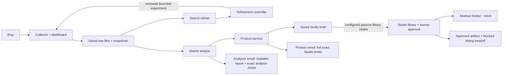

# Market pipeline

File-based market research for digital products: collect → analyze → define a
product brief → Studio approval. Installed production releases are separate
from this source workspace. Product produces a Studio handoff. Studio currently
defaults to mock generation and broker. An explicit development-only OpenAI
adapter has a persistent $1 total envelope; Etsy publishing remains blocked.

One repository contains independently runnable Python services. Python 3.11+
and its standard library support the core services. Product/Studio reference images and
OpenAI image observation additionally require Pillow (optional; verified by preflight).
Ollama
with `gemma3:4b` is needed for actual local inference. OpenAI is optional and
subject to a shared persisted budget. No database or Node dependency is needed.



Product can now deliver saved briefs into Studio's passive library. Import and
browsing never generate images; the user must explicitly start sketches. Existing
installations require enablement and an upgraded receiver; see
[Studio library wiring and backfill](docs/studio-library.md).

## Components

| Component | Interface | Responsibility |
|---|---|---|
| Collector | Dashboard `/` and `/v1`, port 8090 | Search, daily scheduling, tracking, raw provenance, DQA, quota protection |
| Search refiner | Saved-file watcher; HTTP output | Flag irrelevant/physical results and propose more precise keywords |
| Market analyst | Independent saved-file watcher; HTTP output | Evidence-backed product hypotheses, listing content/images and scoped shop history |
| Controller | Loopback port 8094 | Persist proposals, explicit experiment decisions, tracking cohorts, operations and comparisons |
| Product | Loopback port 8093 | Independently define exact product contents, first-sketch instructions, real Etsy references and one HTML brief per product |
| Studio | Hebrew dashboard and HTTP intake, port 8096 | Three-sample batch feedback, compressed brief references, Studio-owned generator prompts, persistent sketch/professional loops; mock defaults and optional $1 development mode |

The analyzers never load Etsy credentials, call Etsy or modify collector input.
Market Insights rebuilds its candidate pool from eligible saved collections as
of each query's finalization, rather than treating a deduplicated collection as
the entire market. Reports distinguish new rows from pooled historical rows.
Historical snapshots must be present in the configured `saved_runs_root`; private
development archives are not automatically imported. See [saved candidate pool](docs/saved-pool.md).
They run independently; one failing does not suppress the other. Completed work
is identified semantically and retained across budget/configuration changes.
HTTP delivery is persisted before acknowledgment and retried without repeating
completed inference. Configured Analyzer/Product mail runs automatically through
separate durable SMTP outboxes: one message per stage and collection. Delivery
failure never repeats inference. The older manually prepared mail CLI retains
its exact-message review requirement.

Collection saves original source responses separately from versioned derived
views. Shop sales are shop-wide counters; favorites/views are listing metrics.
Missing listing sales, purchase demand or search volume remain unknown.
Sparse history does not become a claim of verified high demand or thin supply.

History-aware opportunity qualification, prior-offer suppression, named daily/weekly
research cycles and development-cost estimates are described in
[Research cycles](docs/research-cycles.md). Reports target five to ten qualified new
product briefs and disclose shortfalls; fresh niches can produce explicitly labeled
discovery hypotheses while historical validation remains a separate evidence tier.
Native-currency prices remain separate. Local-only runs can generate up to three
Ollama preview briefs without consuming future production offers. Search experiments
retain niche terms, omit unchanged/duplicate queries and include comparison criteria.
Weekly aggregate trend reporting is deferred.

The default Product path now performs real definition inference (local Ollama,
or explicitly configured OpenAI), rather than copying an Analyzer draft into
generic SVG layouts. It keeps the Analyzer direction unchanged for provenance,
defines an original complete content inventory, verifies reference quotations,
and writes `product.json`, `brief.md` and a standalone `brief.html` per product.
The handoff includes the full exact specification; Studio import remains passive.
See [grounded analysis and product definitions](docs/product-definitions.md) for
configuration, upgrade behavior, quality checks and recovery.

## Verify without credentials

```sh
python3 tools/test.py
python3 tools/publish_check.py
```

Tests use explicitly synthetic fixtures and temporary local HTTP receivers.
They do not call Etsy, OpenAI, SMTP or generate Ollama responses. The suite
includes cross-component flow, credential separation, quota boundaries, durable
completion, graceful process restart and publication checks.

## Run services independently

Keep all runtime files outside this repository:

```sh
python3 deploy/prepare.py --state /tmp/market-pipeline-state --configs /tmp/market-pipeline-config
python3 deploy/launch.py collector --state /tmp/market-pipeline-state --config /tmp/market-pipeline-state/collector/config.json
python3 deploy/launch.py controller --state /tmp/market-pipeline-state --config /tmp/market-pipeline-config/controller.json
python3 deploy/launch.py product --state /tmp/market-pipeline-state --config /tmp/market-pipeline-config/product.json
python3 deploy/launch.py search-refiner --state /tmp/market-pipeline-state --config /tmp/market-pipeline-config/analyzer.json
python3 deploy/launch.py market-analyst --state /tmp/market-pipeline-state --config /tmp/market-pipeline-config/analyzer.json
python3 deploy/launch.py studio --state /tmp/market-pipeline-state --config /tmp/market-pipeline-config/studio.json
```

Use separate terminals/process supervisors. Fresh preparation leaves paid
inference and daily scheduling disabled. It never overwrites existing state.
For real collection, supply a credential directory containing owner-only
`etsy.env`; only the collector reads it. For paid analysis, independently supply
`openai.env`; the paid adapter reads it only after request admission. Credential
values never belong in JSON configuration, command arguments or Git.

For migration, daemon installation, activation and rollback see
[deployment](docs/deployment.md). For policy see [budgets and evidence](docs/policy.md).
For publication see [GitHub preparation](docs/publication.md).
Verification results and limitations are recorded in [verification](docs/verification.md).
For Studio intake, its approval dashboard and mock-provider limits see [Studio](docs/studio.md).

## Upgrade an existing deployment and enable the two-email chain

Pulling code alone preserves existing JSON settings and units. The saved-result
watchers and HTTP Analyzer→Product endpoints remain compatible, but automatic
email requires SMTP configuration, explicit enablement and updated units.
`deploy/prepare.py` deliberately does **not** overwrite installed settings.

1. Stage the new committed release and run `python3 tools/test.py`. Keep runtime
   state, completed receipts, quota history and paid ledgers intact.
2. Provision `/etc/market-pipeline/credentials/gmail_smtp.env` outside Git with
   literal `SMTP_HOST`, `SMTP_PORT`, `SMTP_TLS`, `SMTP_USER`, `SMTP_FROM`,
   `SMTP_PASSWORD` and `SMTP_TO` exports. Gmail supports an app password with
   `smtp.gmail.com`, TLS `ssl`/465 or `starttls`/587. `SMTP_TO` accepts a quoted
   comma-separated recipient list. See [automatic mail](docs/mail.md).
3. Preview, then apply the additive configuration upgrade as the administrator:

   ```sh
   sudo python3 deploy/upgrade_config.py --configs /etc/market-pipeline --enable-mail
   sudo python3 deploy/upgrade_config.py --configs /etc/market-pipeline --enable-mail --apply
   ```

   This enables `mail` in Analyzer and Product, adds missing opportunity settings
   and upgrades the old 2,400-token ceiling to 4,000. It preserves model choices,
   paid enablement/budget/ledger paths, Product promotion review and all state.
   Backups remain beside the settings; existing ownership and permissions survive
   atomic replacement. An optional `--recipients team@example.com` overrides
   `SMTP_TO`. No request or daemon restart is made by this helper.
4. Render/install updated units with SMTP credentials exposed to Market Analyst
   and Product only:

   ```sh
   python3 deploy/render_units.py --with-mail --output /tmp/market-pipeline-units
   systemd-analyze verify /tmp/market-pipeline-units/*.service
   ```

   Follow the [deployment procedure](docs/deployment.md) to install these units,
   select the staged release, run preflight and restart the affected daemons.
   SMTP provisioning must precede starting units rendered with `--with-mail`.
   The collector and both analyzer daemons plus Product/Controller run independently.
5. Trigger a **new manual query** in `/v1`. A successful finalized collection feeds
   both analyzers; Market Insights delivers to Product. Expect one Analyzer email
   with its exact Product-bound JSON and readable report, then one Product email
   with full Studio-ready specifications and exact JSON attachments. If evidence
   is insufficient or analysis is held, messages explain the gap instead of
   inventing opportunities/briefs. No Studio generation is triggered automatically.

Mail activation does not flood older completed collections. Unknown/failed mail
is durable and can be recovered without collecting or inferring again. Paid
analysis still needs its independently supplied OpenAI credential and sufficient
preserved allowance; enabling mail does not enable paid inference or replenish it.

## Runtime outputs

Deployed state is under `/var/lib/market-pipeline`: `collector/`, `analyzer/`,
`controller/`, `product/`, `studio/`, `paid-ledger/` and `local-cache/`. Credentials and
independent analyzer/controller/product/Studio JSON settings belong under
`/etc/market-pipeline`. The collector's saved daily configuration lives in its
writable state directory because dashboard saves use atomic replacement.

Saved runs, raw downloads, images, model outputs, logs, emails and budget/cursor
files are runtime artifacts. They are excluded from the publication repository.
