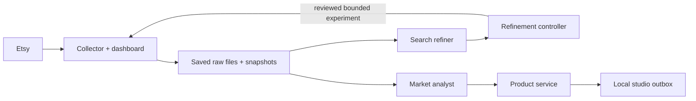

# Market pipeline

File-based market research for digital products: collect → analyze → define a
product brief. This repository is a **pre-deployment candidate**. No production
deployment is claimed. The product stage produces a studio handoff, not a
sale-ready product.

One repository contains independently runnable Python services. Python 3.11+
and its standard library are sufficient for application code and tests. Ollama
with `gemma3:4b` is needed for actual local inference. OpenAI is optional and
subject to a shared persisted budget. No database or Node dependency is needed.



## Components

| Component | Interface | Responsibility |
|---|---|---|
| Collector | Dashboard `/` and `/v1`, port 8090 | Search, daily scheduling, tracking, raw provenance, DQA, quota protection |
| Search refiner | Saved-file watcher; HTTP output | Flag irrelevant/physical results and propose more precise keywords |
| Market analyst | Independent saved-file watcher; HTTP output | Evidence-backed product hypotheses, listing content/images and scoped shop history |
| Controller | Loopback port 8094 | Persist proposals, explicit experiment decisions, tracking cohorts, operations and comparisons |
| Product | Loopback port 8093 | Consume saved market analysis; persist textual studio briefs and original SVG draft directions |

The analyzers never load Etsy credentials, call Etsy or modify collector input.
They run independently; one failing does not suppress the other. Completed work
is identified semantically and retained across budget/configuration changes.
HTTP delivery is persisted before acknowledgment and retried without repeating
completed inference. Email requires review of the exact final message before
sending and is outside automatic daemon delivery.

Collection saves original source responses separately from versioned derived
views. Shop sales are shop-wide counters; favorites/views are listing metrics.
Missing listing sales, purchase demand or search volume remain unknown.
Sparse history does not become a claim of verified high demand or thin supply.

## Verify without credentials

```sh
python3 tools/test.py
python3 tools/publish_check.py
```

Tests use explicitly synthetic fixtures and temporary local HTTP receivers.
They do not call Etsy, OpenAI, SMTP or generate Ollama responses. The suite
includes cross-component flow, credential separation, quota boundaries, durable
completion, graceful process restart and publication checks.

## Run services independently

Keep all runtime files outside this repository:

```sh
python3 deploy/prepare.py --state /tmp/market-pipeline-state --configs /tmp/market-pipeline-config
python3 deploy/launch.py collector --state /tmp/market-pipeline-state --config /tmp/market-pipeline-state/collector/config.json
python3 deploy/launch.py controller --state /tmp/market-pipeline-state --config /tmp/market-pipeline-config/controller.json
python3 deploy/launch.py product --state /tmp/market-pipeline-state --config /tmp/market-pipeline-config/product.json
python3 deploy/launch.py search-refiner --state /tmp/market-pipeline-state --config /tmp/market-pipeline-config/analyzer.json
python3 deploy/launch.py market-analyst --state /tmp/market-pipeline-state --config /tmp/market-pipeline-config/analyzer.json
```

Use separate terminals/process supervisors. Fresh preparation leaves paid
inference and daily scheduling disabled. It never overwrites existing state.
For real collection, supply a credential directory containing owner-only
`etsy.env`; only the collector reads it. For paid analysis, independently supply
`openai.env`; the paid adapter reads it only after request admission. Credential
values never belong in JSON configuration, command arguments or Git.

For migration, daemon installation, activation and rollback see
[deployment](docs/deployment.md). For policy see [budgets and evidence](docs/policy.md).
For publication see [GitHub preparation](docs/publication.md).
Verification results and limitations are recorded in [verification](docs/verification.md).

## Runtime outputs

Deployed state is under `/var/lib/market-pipeline`: `collector/`, `analyzer/`,
`controller/`, `product/`, `paid-ledger/` and `local-cache/`. Credentials and
independent analyzer/controller/product JSON settings belong under
`/etc/market-pipeline`. The collector's saved daily configuration lives in its
writable state directory because dashboard saves use atomic replacement.

Saved runs, raw downloads, images, model outputs, logs, emails and budget/cursor
files are runtime artifacts. They are excluded from the publication repository.
