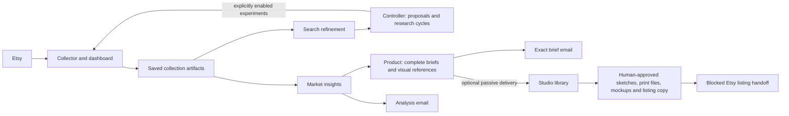

# Market pipeline

A file-based pipeline for researching digital products, writing product briefs,
and creating printable products through a human-reviewed Studio workflow.



**Current status:** the six services are independently deployable. Collection,
analysis, definition, optional email and passive Studio delivery are implemented.
Studio supports real, explicitly configured image providers and saved human
feedback. Etsy publishing is blocked. Broker integrations remain abstract/optional;
Studio defaults to a mock broker. Standalone weekly aggregate analysis is deferred.
Source changes do not deploy a release or overwrite installed configuration.

## Start here

| Task | Guide |
|---|---|
| Understand code ownership and follow a request | [Architecture and code map](docs/architecture.md) |
| Choose settings and safe defaults | [Configuration](docs/configuration.md) |
| Install, upgrade or roll back independent daemons | [Deployment](docs/deployment.md) |
| Run checks and understand their limits | [Verification](docs/verification.md) |
| Operate the Studio and its providers | [Studio](docs/studio.md), [manufacturing workflow](docs/studio-workflow.md) |
| Recover historical Studio jobs | [Studio recovery](docs/studio-recovery.md) |
| Clean development artifacts safely | [Maintenance](docs/maintenance.md) |
| Change this repository | [AGENTS.md](AGENTS.md) |

## Services and boundaries

| Service | Entry point / default interface | Responsibility |
|---|---|---|
| Collector | `services/collector`, dashboard `/` and `/v1`, 8090 | Search/pagination, daily collection, tracking, request quotas and immutable raw snapshots |
| Search refiner | `services/analyzer`, saved-file watcher | Relevance, query improvements and exhaustion evidence; HTTP output to Controller |
| Market analyst | `services/analyzer`, separate watcher | Cumulative saved listing/shop pool, historical assessments, qualified opportunities and HTTP output to Product |
| Controller | `services/controller`, loopback 8094 | Named research cycles, proposals, bounded experiments, cohorts and operation history |
| Product | `services/product`, loopback 8093 | Complete original briefs, first-sketch instructions, actual Etsy reference links and bounded visual reference retrieval |
| Studio | `services/studio`, Hebrew UI / passive intake, 8096 | Sketch approval, printable assembly, mockups, listing copy, preferences and exact image/API history |

Only Collector receives Etsy credentials or calls Etsy. The analysis services
are independent and read saved artifacts; one failing cannot suppress the other.
Repeated completed work does not repeat inference. HTTP and SMTP deliveries have
separate durable outboxes and explicit recovery. Product-to-Studio delivery never
starts generation: a human must start a saved brief in the UI.

Listing views/favourites and shop-wide sales are evidence with different scopes.
Missing listing sales, verified demand and market size remain unknown. Reports
target five to ten qualified opportunities without padding missing evidence.
See [saved pools](docs/saved-pool.md), [research cycles](docs/research-cycles.md),
and [grounded Product definitions](docs/product-definitions.md).

## Dependencies and offline verification

Python 3.11+ runs the core services. Pillow is required for the complete test suite,
Product visual references and Studio raster/print features. Print rendering also
needs DejaVu Sans and Pillow RAQM support. The tested development environment uses
Python 3.12 and Pillow 10.2; no database, Node runtime or JavaScript build is needed.

In an environment you manage, install the declared dependency before running all
checks:

```sh
python3 -m pip install -r requirements.txt
python3 tools/test.py
```

Tests use synthetic inputs and temporary local transports. They make no paid,
Etsy, Ollama-generation or SMTP calls. Firefox/geckodriver are optional for the
[separate browser checks](docs/verification.md). Local Ollama with `gemma3:4b` is
needed only for configured real local inference, not offline verification.

## Run independently in development

Keep state, configuration, outputs and credentials **outside the checkout**.
Preparation creates missing settings only: scheduling, paid inference and optional
mail/Studio delivery start disabled. Existing settings and ledgers are preserved.

```sh
python3 deploy/prepare.py --state /tmp/market-pipeline-state --configs /tmp/market-pipeline-config
python3 deploy/launch.py collector --state /tmp/market-pipeline-state --config /tmp/market-pipeline-state/collector/config.json
```

Run each additional service in its own terminal/supervisor, using the same state
root and its configuration from `/tmp/market-pipeline-config`:
`search-refiner` and `market-analyst` use `analyzer.json`; `controller`, `product`
and `studio` use their respective JSON files. The launcher defaults to loopback;
network exposure and credentials require explicit configuration. See
[configuration](docs/configuration.md) for examples and activation requirements.

The shared Analyzer/Product development envelope is **$2 total**, including prior
charges/reservations. Studio has a **separate explicitly authorized $25 trial**
with its existing allocations; the old `$1` default remains a compatibility
setting, not a reset or a new allowance. Runtime ledgers are authoritative.
See [policy](docs/policy.md). No cleanup, restart or deployment replenishes credit.

## Upgrade an existing deployment

Do not copy examples over live settings or rerun initial migration into installed
state. Stage a verified release, back up state and follow the
[deployment upgrade procedure](docs/deployment.md#upgrade-an-existing-deployment).
Configuration changes and unit installation are separate administrator actions.

Mail requires a protected SMTP credential and explicit activation in both Analyzer
and Product; see [mail setup](docs/mail.md). A finalized manual collection can then
produce one Analyzer email (readable report and exact Product-bound JSON) and one
Product email (full exact Studio brief). Passive Studio delivery is separately
configured; see [library wiring and backfill](docs/studio-library.md). Enabling
these connections neither enables paid models nor reprocesses old completed work.

## Runtime data and publication

Production code, configuration and state are separate:
`/opt/market-pipeline/releases/<commit>`, `/etc/market-pipeline`, and
`/var/lib/market-pipeline`. The designated daemon account is `market-pipeline`.
The source workspace is not the installed release or a backup of its state.

Raw collections, generated images, model responses, ledgers, mail, credentials and
private reports are excluded from Git. Keep their history and recovery receipts.
Run `python3 tools/publish_check.py` from a clean committed tree before publishing;
the pre-push hook repeats this audit across all Git objects. See
[publication](docs/publication.md), [sanitation](docs/sanitation.md), and
[delivery recovery](docs/delivery.md). Git history records superseded development
work; current behavior and operating instructions belong in the guides above.
